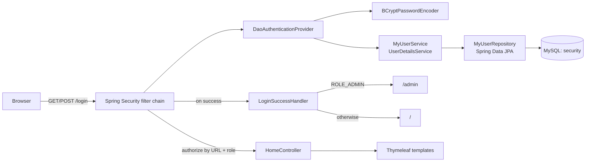

# Spring Boot Security – Role-Based Login

[](https://github.com/Neeraj95464/SpringBootSecurity/actions/workflows/ci.yml)

A Spring Boot 3 / Spring Security 6 web application that shows how to secure a server-rendered app end to end: a custom login page, users and roles stored in MySQL through JPA, BCrypt password hashing, role-based URL protection and a post-login redirect that depends on the user's role.

## Features

- **Custom form login**: `GET /login` serves a Thymeleaf login page (`custom_login.html`); Spring Security processes the `POST /login`.
- **Database-backed users**: `MyUserService` implements `UserDetailsService` and loads users from a JPA entity (`MyUser`: `id`, `name`, `password`, `role`) through `MyUserRepository`.
- **BCrypt password hashing**: a `BCryptPasswordEncoder` bean is wired into a `DaoAuthenticationProvider`.
- **Role-based access control** (`SecurityFilterChain`):
  - `/` and `/registration/**` are public
  - `/admin/**` requires `ROLE_ADMIN`
  - `/user/**` requires `ROLE_USER`
  - every other request requires authentication
- **Role-aware redirect after login**: `LoginSuccessHandler` (extends `SavedRequestAwareAuthenticationSuccessHandler`) sends admins to `/admin` and other users to `/`, unless a saved request takes priority.
- **Custom error pages**: static `403.html` (access denied) and `404.html` (not found) under `src/main/resources/public/error/`.
- **Thymeleaf views** for the home, login, user and admin pages.

## Architecture



## Endpoints

| Method | Path     | Access              | View / behaviour                                   |
|--------|----------|---------------------|----------------------------------------------------|
| GET    | `/`      | Public              | `home.html`                                        |
| GET    | `/login` | Public              | `custom_login.html` (custom login form)            |
| POST   | `/login` | Public              | Handled by Spring Security form login              |
| GET    | `/user`  | `ROLE_USER`         | `normalUser.html`                                  |
| GET    | `/admin` | `ROLE_ADMIN`        | `adminPage.html`                                   |
| GET    | `/logout`| Any                 | Spring Security logout, redirects to `/login?logout` |

Anonymous users who hit a protected URL are redirected to `/login`; signed-in users without the required role get the custom 403 page, and unknown URLs get the custom 404 page.

## Tech stack

- Java 21, Spring Boot 3.2
- Spring Security 6 (form login, `DaoAuthenticationProvider`, BCrypt)
- Spring Data JPA / Hibernate, MySQL (`mysql-connector-j`)
- Thymeleaf (plus the `thymeleaf-extras-springsecurity6` dependency)
- Lombok, Maven, GitHub Actions

## Getting started

### Prerequisites

- JDK 21
- MySQL running on `localhost:3306` with a database named `security`

```sql
CREATE DATABASE security;
```

### Configure credentials

Database credentials are read from environment variables (see `.env.example`):

| Variable      | Default | Purpose                  |
|---------------|---------|--------------------------|
| `DB_USERNAME` | `root`  | MySQL user               |
| `DB_PASSWORD` | (empty) | MySQL password           |

```bash
export DB_USERNAME=root
export DB_PASSWORD=your-password
```

On Windows PowerShell: `$env:DB_USERNAME="root"; $env:DB_PASSWORD="your-password"`.

### Run

```bash
./mvnw spring-boot:run        # Windows: mvnw.cmd spring-boot:run
```

Open <http://localhost:8080>. Hibernate creates the `my_user` table on first start (`ddl-auto=update`).

### Create a user

There is no sign-up page yet, so insert users directly. Passwords must be BCrypt hashes, and `role` holds the role name without the `ROLE_` prefix (`USER` or `ADMIN`):

```sql
INSERT INTO my_user (id, name, password, role)
VALUES (1, 'admin', '<bcrypt-hash>', 'ADMIN');
```

Any BCrypt generator (for example `new BCryptPasswordEncoder().encode("...")`) can produce the hash.

### Build

```bash
./mvnw -B package -DskipTests
```

CI builds with `-DskipTests` because the Spring context test needs a live MySQL database.

## Roadmap (planned)

- [ ] Registration endpoint under `/registration/**` (already permitted in the security config) with BCrypt encoding on sign-up
- [ ] Return a clean `UsernameNotFoundException` for unknown users in `MyUserService` (check `Optional` before calling `get()`)
- [ ] Re-enable CSRF protection and add the token to the login form
- [ ] Use `sec:authorize` from thymeleaf-extras-springsecurity6 to show role-specific links
- [ ] Integration tests with Testcontainers MySQL and `spring-security-test`
- [ ] Docker Compose file for the app plus MySQL

## Author

**Neeraj Kumar** – Java / Spring Boot developer

- LinkedIn: [neeraj-kumar-10bbb8284](https://www.linkedin.com/in/neeraj-kumar-10bbb8284/)
- GitHub: [@Neeraj95464](https://github.com/Neeraj95464)
